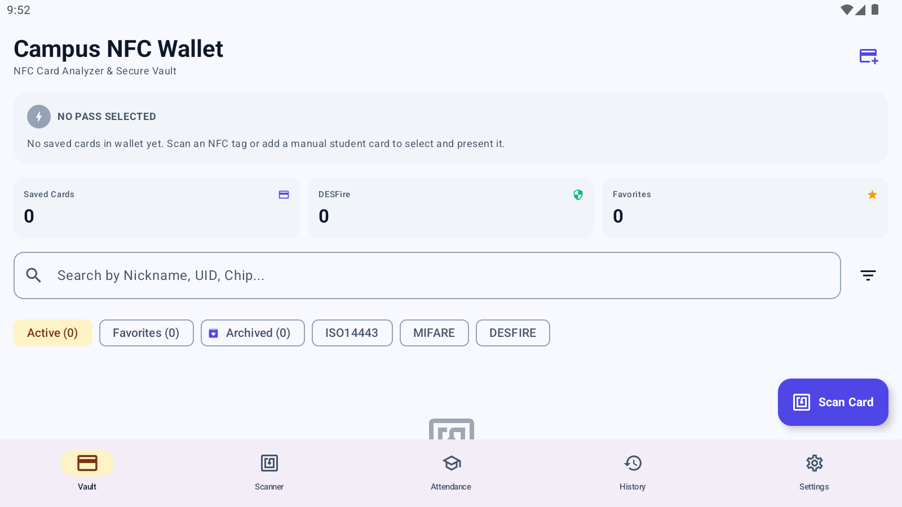
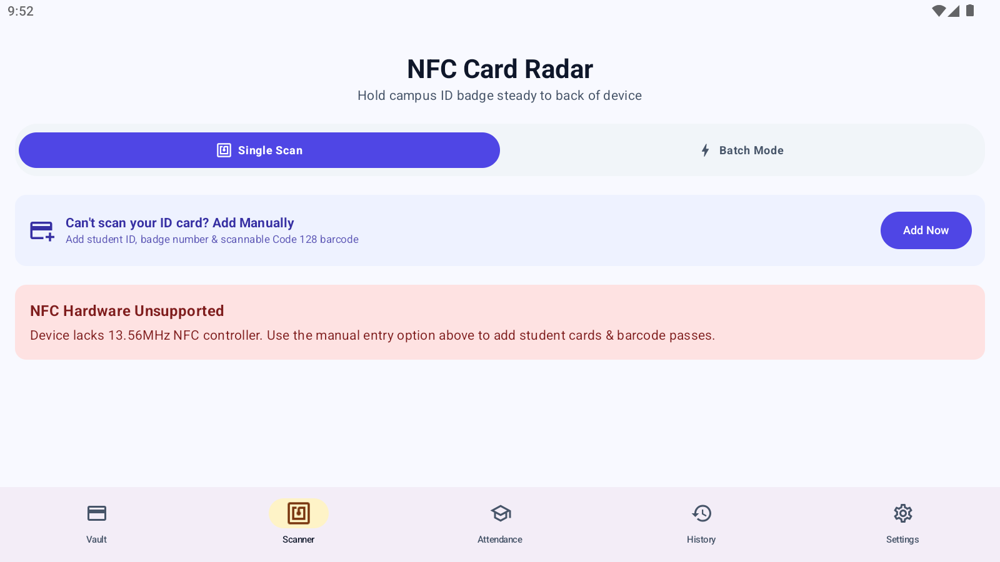
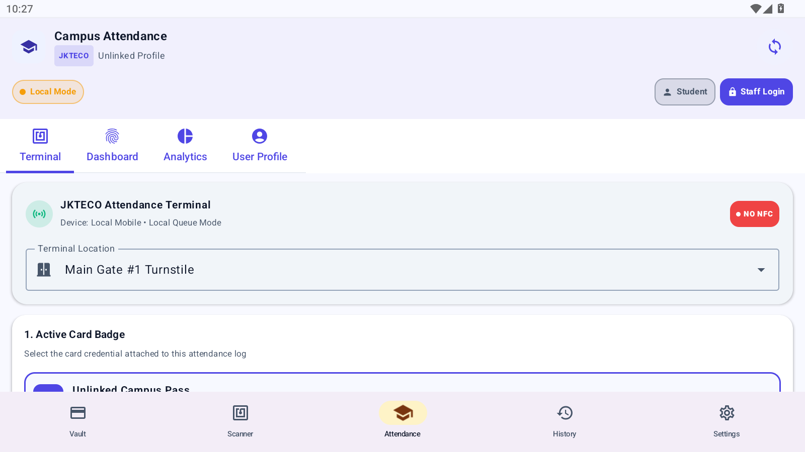
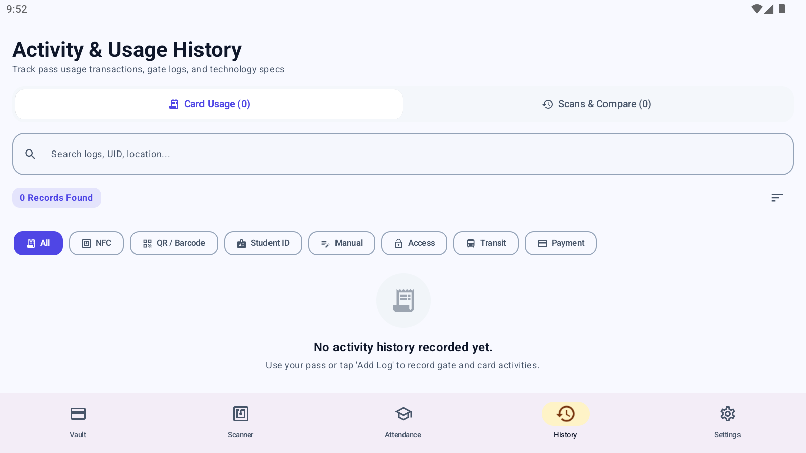
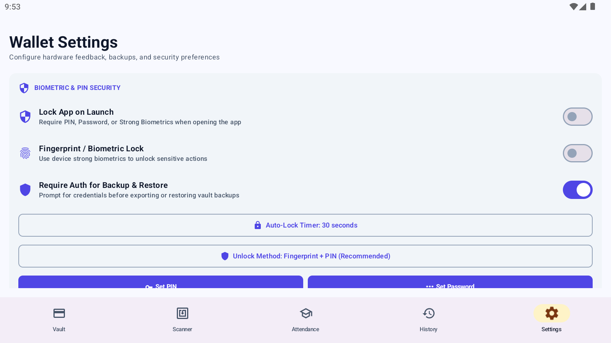

<div align="center">
  
  <h1>Campus NFC Wallet</h1>
  <p><strong>Enterprise-Grade University NFC Card Analyzer, Encrypted Digital Pass Vault &amp; Campus Attendance Terminal for Android</strong></p>

  <p>
    
    
    
    
    
  </p>

  <p>
    <a href="releases/CampusNfcWallet-v1.0.0-debug.apk"><strong>📦 Download Ready-to-Install APK (v1.0.0)</strong></a>
  </p>
</div>

---

## 📸 Screenshots

| **1. Encrypted Card Vault** | **2. NFC Hardware Radar** | **3. Campus Attendance & RBAC** |
| :---: | :---: | :---: |
|  |  |  |

| **4. Activity & Usage History** | **5. Security & Server Sync Settings** |
| :---: | :---: |
|  |  |

---

## ✨ Key Features

### 1. Real 13.56 MHz NFC Hardware Diagnostics
- Reads & decodes **ISO/IEC 14443-3A** (`NfcA`, `MifareClassic`, `MifareUltralight` / `NTAG`), **ISO/IEC 14443-3B** (`NfcB`), **ISO/IEC 14443-4** (`IsoDep` / `MIFARE DESFire`), **JIS X 6319-4** (`NfcF` / `FeliCa`), **ISO/IEC 15693** (`NfcV`), and **NDEF** records.
- Accurately decodes LSB-first **ATQA**, **SAK** bitmasks, **ATS / Historical Bytes**, 7-byte IC Manufacturer prefixes (per ISO/IEC 7816-6), and 4-byte Random UIDs (`0x08` RID).
- Performs non-intrusive security & cloning risk evaluation without brute-forcing or modifying physical cards.
- Supports **Single Scan**, **Batch Queue Scanning**, and **Side-by-Side Card Comparison**.

### 2. ISO/IEC 15417 Code 128B Digital Student Pass
- Pure-Kotlin **Code 128 (Set B)** barcode encoder (`Code128Encoder.kt`) with Start B (`104`), Modulo-103 checksum, Stop (`106`), and 10-module quiet zones for optical campus gate turnstiles.
- Full-screen **Optical Turnstile Pass** mode automatically boosts display brightness to 100% and restores user brightness on exit.

### 3. Defense-in-Depth Security Architecture
- **Hardware-Backed Encryption at Rest:** All saved card payloads and server API credentials stored in Room SQLite are encrypted with **AES-256-GCM** via Android Keystore (`KeystoreManager.kt`, `setUnlockedDeviceRequired(true)` on API 28+, fail-closed with zero plaintext fallback).
- **Salted PBKDF2-HMAC-SHA256 Authentication:** App Lock PINs (4–6 digits), Master Passwords (8+ chars), recovery answers, and Teacher/Admin staff passcodes are hashed with **120,000 iterations** of `PBKDF2WithHmacSHA256` + 16-byte `SecureRandom` salts and verified in constant time (`MessageDigest.isEqual`).
- **Persistent Anti-Brute-Force Lockout:** 5 failed attempts trigger a 30-second lockout persisted across screen rotations and app restarts.
- **Class 3 Biometrics & Screen Privacy:** Enforces `BiometricManager.Authenticators.BIOMETRIC_STRONG`, enables `WindowManager.LayoutParams.FLAG_SECURE` whenever App Lock is active, uses monotonic `SystemClock.elapsedRealtime()` for auto-lock timeouts, and disables unencrypted cloud auto-backup (`android:allowBackup="false"`).

### 4. Portable Encrypted Backups (`.cardvaultbackup` v2)
- Full-vault and category-selective backups encrypted with **210,000 PBKDF2-HMAC-SHA256 iterations** + **AES-256-GCM** and **Authenticated Header AAD** (detects header/version tampering).
- Supports **Atomic Replace** and **Deduplicated Merge** restore modes with automatic foreign-key remapping across devices.
- Includes internal rotating snapshots, Storage Access Framework (SAF) file export/import, and Android 13+ `EXTRA_IS_SENSITIVE` clipboard protection.

### 5. Protected Teacher / Admin RBAC & Campus Server Sync
- **Role-Based Access Control (`RoleAccessManager.kt`):**
  - Boots into least-privilege **`STUDENT`** mode by default.
  - **`TEACHER`** and **`ADMIN`** capabilities (editing attendance statuses, viewing/clearing audit logs, managing server config & staff passcodes) are enforced at both the UI and ViewModel layers.
  - Roles can be unlocked via **Server-Verified Account Login** or **PBKDF2-hashed Staff/Admin Passcodes**.
- **Unified Campus Server Link (`CampusServerSyncService.kt`):**
  - Synchronizes saved NFC cards, usage transactions, and attendance punches with your campus REST server (`JKTECO`, `Suprema`, `HID`, `Gallagher`, or `Custom University REST API`).

---

## 🌐 Campus Server REST API Contract

When linking the app to your university backend in **Settings → Campus Server & Wallet Sync**, the client communicates with the following JSON endpoints:

| Method & Path | Purpose | Request / Headers | Expected Response (`200 OK`) |
| :--- | :--- | :--- | :--- |
| `POST /api/v1/auth/login` | Account sign-in & server-verified role assignment | `{ "username": "...", "password": "...", "deviceId": "..." }` | `{ "token": "<jwt>", "role": "STUDENT\|TEACHER\|ADMIN", "userId": "...", "name": "...", "department": "...", "email": "...", "expiresAt": 1790000000000 }` |
| `GET /api/v1/health` | Server health & credential check | `Authorization: Bearer <jwt>` or `X-API-KEY: <key>` | `{ "status": "ok" }` |
| `POST /api/v1/wallet/sync/cards` | Push local wallet cards & pull server-issued passes | `{ "deviceId": "...", "campusId": "...", "studentId": "...", "cards": [...] }` | `{ "status": "ok", "serverCards": [{ "uid": "...", "nickname": "...", "manufacturer": "...", "technology": "..." }] }` |
| `POST /api/v1/wallet/sync/transactions` | Push card usage activity logs | `{ "deviceId": "...", "campusId": "...", "studentId": "...", "transactions": [...] }` | `{ "status": "ok" }` |

---

## 🚀 Installation & Build Instructions

### Option A: Install Prebuilt APK (Fastest)
1. Download [`releases/CampusNfcWallet-v1.0.0-debug.apk`](releases/CampusNfcWallet-v1.0.0-debug.apk).
2. Install on a physical Android device or emulator (such as MuMuPlayer):
   ```bash
   adb install -r releases/CampusNfcWallet-v1.0.0-debug.apk
   adb shell am start -n com.aistudio.campusnfcwallet.xqpz/com.example.MainActivity
   ```

### Option B: Build from Source
1. **Prerequisites:**
   - **JDK 21** (`JAVA_HOME` pointing to JDK 21)
   - **Android SDK Platform 36** (`ANDROID_HOME` pointing to your Android SDK)
2. **Build Debug APK & Run All Unit Tests:**
   ```bash
   ./gradlew assembleDebug testDebugUnitTest compileDebugAndroidTestKotlin
   ```
   The compiled APK will be generated at `app/build/outputs/apk/debug/app-debug.apk`.

---

## 🗂️ Project Structure

```text
app/src/main/java/com/example/
├── attendance/          # Campus Attendance Terminal, Providers (JKTECO/Suprema/HID/Gallagher/Custom) & RBAC Dialog
├── backup/              # AES-256-GCM + PBKDF2 (210k) Backup/Restore Engine, Validator & Atomic Restore Manager
├── data/                # Room Database v6 (Cards, Transactions, Attendance), Migrations & Encrypted Repositories
├── di/                  # Manual Dependency Injection Container (AppContainer)
├── nfc/                 # Real NFC Tag Analyzer, ISO 14443/15693 Decoder & Live NFC State Observer
├── security/            # Android Keystore AES-256-GCM Manager & RoleAccessManager (Student/Teacher/Admin RBAC)
├── sync/                # Unified CampusServerSyncService (Account Login, Card Sync, Transaction Sync)
├── ui/                  # Jetpack Compose Screens, Material 3 Theme (Light/Dark) & Reusable Components
└── utils/               # ISO/IEC 15417 Code128Encoder, Strong BiometricUtils, Safe CSV/JSON Exporter
```

---

## 👨‍💻 Developer

- **Author:** MD.Shakil Ahmad Nahid
- **Institution:** Southeast University
- **Contact:** [shakilahmad42052@gmail.com](mailto:shakilahmad42052@gmail.com)
